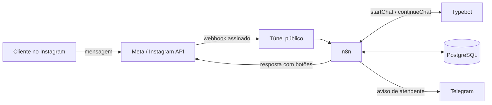

# TS PickUps Chatbot
[](https://github.com/tvrsdigital/ts-pickups-chatbot/actions/workflows/ci.yml)

Assistente virtual para atendimento no **Instagram Direct** de um pequeno negócio (fabricação artesanal de captadores para guitarra e baixo). O robô conduz o cliente por perguntas simples até recomendar o captador ideal e, quando o cliente quiser, passa a conversa a um atendente humano.

Construído com ferramentas **gratuitas e de baixo código**: Typebot, n8n, PostgreSQL e Docker.

> Projeto acadêmico e de portfólio. Política de privacidade: https://tvrsdigital.github.io/ts-pickups-chatbot/privacidade/

## O que o robô faz

- Recebe mensagens do Instagram e responde com botões de resposta rápida.
- Segue um fluxo de decisão com **29 caminhos**: até 9 recomendações de produto, atendente humano e a opção de encerrar o robô.
- Encaminha ao atendente humano: o robô se cala por 24 horas e um aviso chega ao Telegram com o nome e o @ do cliente.
- Permite desativar o robô em uma conversa: o cliente escolhe **Não quero o robô** no menu, ou o atendente toca em um botão no aviso do Telegram. O robô só volta quando a equipe reativa.
- Valida a assinatura de cada webhook da Meta, descarta mensagens repetidas e se recupera de sessões expiradas.
- Registra métricas anonimizadas (latência e opções escolhidas) e apaga dados antigos automaticamente (LGPD).

## Arquitetura



- **Typebot** guarda o fluxo de conversa (menus, textos e recomendações).
- **n8n** faz a ponte com a Meta: valida a assinatura, evita respostas duplicadas, mantém a sessão e envia as respostas.
- **PostgreSQL** guarda sessões, controle de mensagens, métricas anonimizadas, a lista de quem não quer o robô e configurações.
- **Túnel (ngrok)** expõe o n8n local para a Meta durante o desenvolvimento.

## Por que essas ferramentas

| Necessidade | Escolha | Motivo |
|---|---|---|
| Desenhar o fluxo de conversa | Typebot (auto-hospedado) | Editor visual gratuito, API de conversa pronta |
| Integrar com o Instagram e orquestrar | n8n Community | Fluxos visuais, nós de Postgres e Telegram, sem custo |
| Persistência | PostgreSQL 16 | Simples, robusto, já usado pelo Typebot |
| Ambiente reproduzível | Docker Compose | Um comando sobe tudo |
| Exposição do webhook | ngrok (plano gratuito) | Domínio fixo gratuito para desenvolvimento |
| Aviso ao atendente | Telegram Bot | Gratuito e imediato |
| E-mails de login do Typebot | Mailpit | Caixa de entrada falsa local |


## Como rodar

**Pré-requisitos:** Docker Desktop, Node.js 18 ou mais novo, um app na Meta com o produto Instagram, um domínio gratuito do ngrok e um bot do Telegram.

1. Clone o repositório e copie `infra/.env.example` para `infra/.env`, preenchendo os valores (nunca commite o `.env`).
2. Suba o Typebot (`infra/typebot`) e a pilha do bot (`infra`):

   ```bash
   cd infra/typebot && docker compose up -d
   cd .. && docker compose up -d
   ```

3. No Typebot, importe `flow/typebot-export.json`, publique e anote o *Public ID* em `TYPEBOT_PUBLIC_ID`.
4. No n8n (`http://localhost:5678`), importe os workflows de `n8n/workflows/`, crie as credenciais `bot-db` (Postgres), `ig-token` (Header Auth com `Authorization: Bearer <token>`) e `telegram-avisos`, e publique os workflows. Em cada workflow, em **Settings**, escolha o **99-erros** como Error Workflow.
5. Na Meta, cadastre o webhook `https://<seu-dominio-ngrok>/webhook/ig` com o token de verificação do `.env` e assine o campo `messages`.

Nunca use `docker compose down -v`: o `-v` apaga os volumes, inclusive o do n8n.

Para ligar, desligar e resolver erros no dia a dia, veja o [guia de operação](docs/operacao.md).

Para ver o fluxo de conversa e os workflows em slides, veja a [apresentação](docs/apresentacao.md).

## Testes

Todos rodam na raiz do projeto.

| Comando | O que verifica |
|---|---|
| `node tests/generate-paths.js` | Valida o `flow/flow.json` e gera os 29 caminhos |
| `node tests/check-labels.js` | Garante que todo botão tem até 20 caracteres (limite do Instagram) |
| `node tests/simulate-typebot.js` | Percorre os 29 caminhos na API do Typebot e confere link, nome do produto e desfecho |
| `node tests/simulate-n8n.js` | Envia webhooks assinados ao n8n (com `DRY_RUN=true`) e confere os eventos no banco |
| `node tests/concurrency-n8n.js` | Envia 20 pessoas ao mesmo tempo e 5 cópias da mesma mensagem (exige `DRY_RUN=true`); confere 1 evento por pessoa e por mensagem |

Resultados guardados em `tests/resultado-typebot.txt` e `tests/resultado-n8n.txt`.

## Resultados

- **29 de 29 caminhos** aprovados no Typebot e pelo n8n.
- Processamento interno (modo simulado, 133 mensagens): média de **55 ms**, p95 de **66 ms**, máximo de **196 ms**.
- Com envio real ao Instagram (79 mensagens de 6 contas): média de **1,3 s**, mediana de 1,2 s, p95 de 1,7 s e máximo de 2,9 s.
- Os testes encontraram quatro problemas reais: um botão ausente no menu de baixos, um erro de digitação em duas recomendações, rótulos de botão acima do limite do Instagram e mensagens repetidas processadas em paralelo (corrigido com o nó **Mensagem nova?**).
- Robustez: figurinha, imagem, áudio e texto livre (testes manuais, em duas contas); Typebot fora do ar, com aviso no Telegram pelo workflow 99-erros; 20 pessoas ao mesmo tempo e 5 cópias da mesma mensagem (`tests/concurrency-n8n.js`).

## Estrutura do repositório

```text
flow/        fluxo em JSON, esquema, produtos e exportação do Typebot
infra/       Docker Compose, banco (init) e exemplo de variáveis de ambiente
n8n/         workflows exportados
tests/       validadores, simuladores e resultados
docs/        política de privacidade (GitHub Pages) e documentação
```

## Decisões e limitações

- **Plataforma em mudança.** O login do Instagram usado em guias antigos (tokens de 60 dias) não estava disponível para apps novos. O projeto usa o **login unificado** com token de usuário do sistema, que não expira. Por isso o antigo workflow `03-renovar-token` deixou de existir e a numeração dos workflows pula do 02 para o 04.
- **Acesso da Meta.** Em novembro de 2026, um app em modo Live com acesso padrão, usado só na conta do próprio negócio, atendeu contas sem função no app, sem passar por revisão. É uma observação de um único app, sujeita a mudanças da Meta.
- **Texto livre.** O Typebot responde "Invalid message" em inglês quando o cliente digita em vez de clicar. A versão usada não permite alterar essa mensagem; o n8n substitui o texto por uma frase em português. É uma troca por texto exato e pode quebrar se o Typebot mudar a frase.
- **Execução local.** O bot só funciona com o computador ligado e o túnel ativo. Hospedagem 24 horas é trabalho futuro.

## Privacidade e LGPD

O robô guarda o identificador do Instagram apenas na tabela de sessões (apagada após 30 dias sem atividade). As métricas usam um hash do identificador e nunca guardam o texto digitado. Um workflow diário apaga dados antigos. Veja a [política de privacidade](https://tvrsdigital.github.io/ts-pickups-chatbot/privacidade/). Quem pede para não usar o robô fica registrado apenas por um hash, sem prazo de expiração.

## Trabalho futuro

- Testes de robustez automáticos e de carga maior (inclui queda do banco de dados).
- Hospedagem 24 horas gratuita.

## Licença

Veja o arquivo [LICENSE](LICENSE).