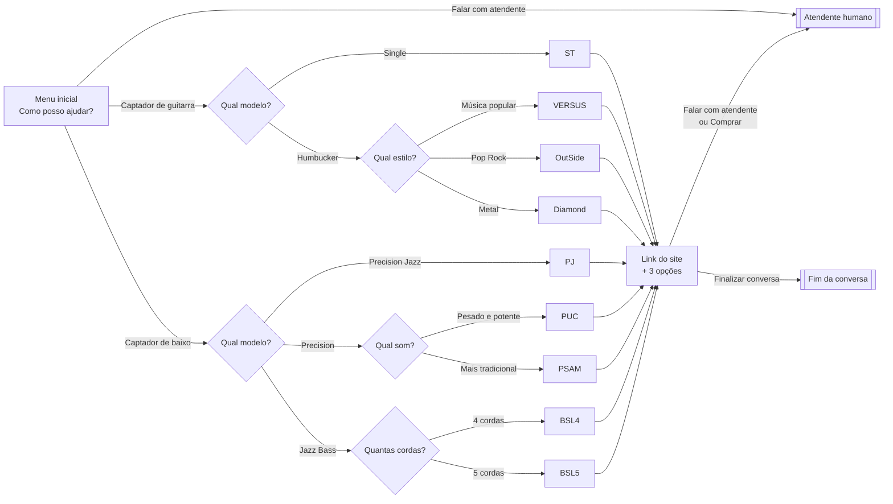
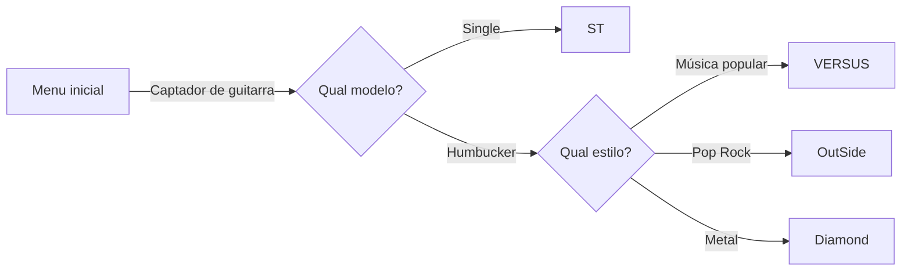
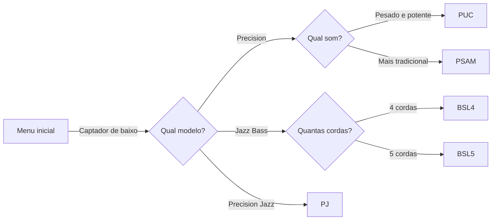
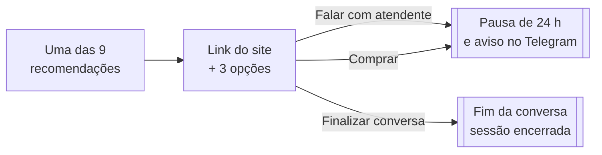
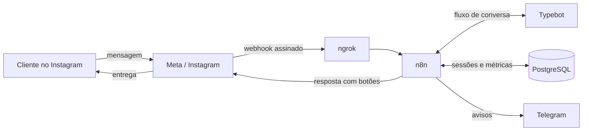
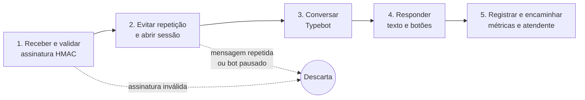
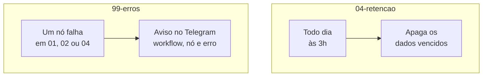

# Chatbot de atendimento no Instagram

O fluxo de conversa e os workflows do robô da **TS PickUps**

[Karen, Noah, Paula, Rafael e Ramon] · [Fundamentos de Sistemas de Informação] · Novembro de 2026

---

## O fluxo completo de conversa

---

## Guitarra: até 3 perguntas

- **Single** leva direto ao ST
- **Humbucker** pergunta o estilo musical e leva a um entre três modelos

---

## Baixo: três modelos, duas perguntas extras

- **Precision** pergunta o som e **Jazz Bass** pergunta as cordas
- **Precision Jazz** leva direto ao PJ

---

## Depois da recomendação

- Quem digita em vez de tocar no botão recebe um aviso em português e a mesma pergunta
- O cliente pode pedir um atendente em qualquer ponto

**28 caminhos**: **19** terminam no atendente e **9** no fim da conversa.

---

## Arquitetura: quem conversa com quem

---

## Os 4 workflows do n8n

| Workflow | O que faz |
|---|---|
| **01-verificacao-webhook** | Responde à verificação que a Meta faz ao cadastrar o webhook |
| **02-mensagens** | Recebe cada mensagem, conversa com o Typebot e responde |
| **04-retencao** | Apaga os dados vencidos todo dia |
| **99-erros** | Avisa no Telegram quando um nó falha |

*A numeração pula o 03: o workflow de renovar token foi descartado, porque o token não expira.*

---

## 02-mensagens: da chegada à resposta

- O filtro **Mensagem nova?** descarta cópias da mesma mensagem, mesmo em paralelo
- Ao pedir atendente, o robô pausa por 24 horas e avisa no Telegram

---

## 99-erros e 04-retencao

- **Retenção:** sessões 30 dias, controle de repetição 7 dias, métricas 12 meses
- **Exemplo de erro:** com o Typebot desligado, o aviso chega ao Telegram; ao religar, o robô volta sozinho

---
## Testes e resultados

|              |                                                                              |
| ------------ | ---------------------------------------------------------------------------- |
| **28 de 28** | caminhos aprovados no Typebot e pelo n8n                                     |
| **49 ms**    | processamento interno médio (p95: 55 ms; modo simulado)                      |
| **1,3 s**    | resposta média com envio real (79 medidas, 6 contas)                         |
| **4 falhas** | achadas pelos testes e corrigidas, incluindo mensagens repetidas em paralelo |

Também testados: Typebot fora do ar, 20 pessoas ao mesmo tempo, figurinha, imagem e áudio.

---

# Obrigado

**Próximos passos:** hospedagem 24 horas e testes de carga

**Justificativa, ferramentas e análise completa:** no artigo

**Repositório:** github.com/tvrsdigital/ts-pickups-chatbot

Perguntas?
