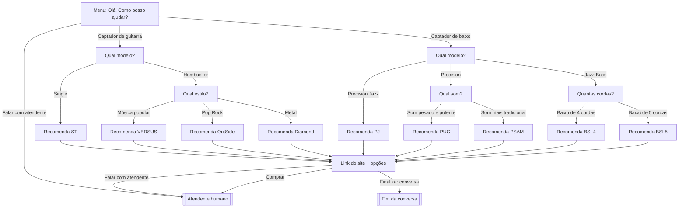

# Arquitetura

## Fluxo de conversa (28 caminhos)

Todas as nove recomendações levam ao mesmo bloco final (link do site) e, de lá, ao atendente ou ao fim. Total: **28 caminhos ponta a ponta** (19 terminam em atendente e 9 em fim de conversa).

## Pipeline do n8n (workflow `02-mensagens`)

| # | Nó | Função |
|---|---|---|
| 1 | Receber POST | Recebe o webhook da Meta e responde 200 imediatamente, guardando o corpo bruto |
| 2 | Validar Assinatura | Recalcula o HMAC-SHA256 com o App Secret e compara em tempo constante |
| 3 | If | Assinatura inválida vai para **Descartar** |
| 4 | Extrair eventos | Gera um item por mensagem (formatos `messaging` e `changes`), ignora ecos e marca a hora de chegada |
| 5 | Deduplicar mid / Mensagem nova? | Insere o ID da mensagem em `processed_mids`. Se já existir, a consulta não devolve o ID e o nó If manda a mensagem para **Ignorar (mensagem repetida)** |
| 6 | Consultar desativação / Robô ativo? | Procura o hash do cliente em `optouts`. Se ele pediu para não usar o robô (ou o atendente desativou), a mensagem vai para **Ignorar (robô desativado)** |
| 7 | Abrir sessão | Cria ou atualiza a sessão do cliente e informa se o bot está pausado |
| 8 | Bot pausado? | Se um atendente assumiu, **Ignorar** |
| 9 | Tem sessão Typebot? | Sem sessão: `startChat`. Com sessão: `continueChat` (se der "Session not found", reinicia com `startChat`) |
| 10 | Salvar sessão | Ramo paralelo que grava o `sessionId` do Typebot |
| 11 | Montar Resposta | Converte o texto do Typebot, extrai os botões, retira os marcadores `[[HANDOFF]]`, `[[END]]` e `[[OPTOUT]]` e traduz o aviso de opção inválida |
| 12 | Preparar envios | Monta o JSON do Instagram (um envio por texto; botões como respostas rápidas de até 20 caracteres, só na última mensagem) |
| 13 | Modo Simulado? | `DRY_RUN=true` não envia nada; `false` chama **Enviar ao Instagram** |
| 14 | Calcular métricas / Registrar evento | Grava evento anonimizado (hash, tipo, botão e latência) |
| 15 | Encerrar ou Pausar? / Atualizar sessão | No fim da conversa limpa a sessão; no atendimento também pausa o bot por 24 h; no opt-out do cliente, também grava o hash em `optouts` |
| 16 | É handoff? / Buscar perfil do cliente / Avisar atendente | Consulta o nome e o @ na API da Meta (se falhar, o aviso sai sem eles) e envia ao Telegram um aviso com o botão **Desativar robô** (somente fora do modo simulado) |
Outros workflows: `01-verificacao-webhook` (responde ao desafio GET da Meta), `04-retencao` (apaga dados antigos todo dia às 3h) e `05-telegram-botoes` (recebe o toque no botão do aviso do Telegram, confere se veio do chat autorizado e grava ou remove o cliente em `optouts`, depois confirma e troca o botão entre "Desativar" e "Reativar robô").

## Banco de dados

| Tabela | Conteúdo | Retenção |
|---|---|---|
| `sessions` | ID do Instagram, sessão do Typebot e pausa do atendimento | 30 dias sem atividade |
| `processed_mids` | IDs de mensagens já processadas | 7 dias |
| `events` | Estatísticas anonimizadas (hash, tipo, botão e latência) | 12 meses |
| `optouts` | Hash do cliente que não quer o robô, origem (`cliente` ou `atendente`) e data | Sem expiração (até reativar ou excluir) |
| `config` | Reservada para configurações | — |

## Segurança

- Assinatura de cada webhook validada com o App Secret.
- Segredos só em `infra/.env` (fora do Git); tokens em credenciais criptografadas do n8n.
- IDs reais apenas em `sessions`; as métricas usam hash com sal.
- O texto digitado pelo cliente não é armazenado nas métricas.
- O toque no botão do Telegram só é aceito quando vem do chat autorizado (`TELEGRAM_CHAT_ID`).
- O nome e o @ do cliente aparecem só no aviso do Telegram; não são gravados em nenhuma tabela. O opt-out guarda apenas o hash.

## Tratamento de erros

Os workflows 01, 02 e 04 usam o **99-erros** como fluxo de erro. Quando um nó falha, o n8n chama o 99-erros. Ele envia ao Telegram o nome do workflow, o nó que falhou, a mensagem de erro e o número da execução.

Exemplo: com o Typebot desligado, o nó **Typebot startChat** falha com "The service refused the connection", e o aviso chega ao Telegram. Ao religar o Typebot, o robô volta a responder sem outra ação.